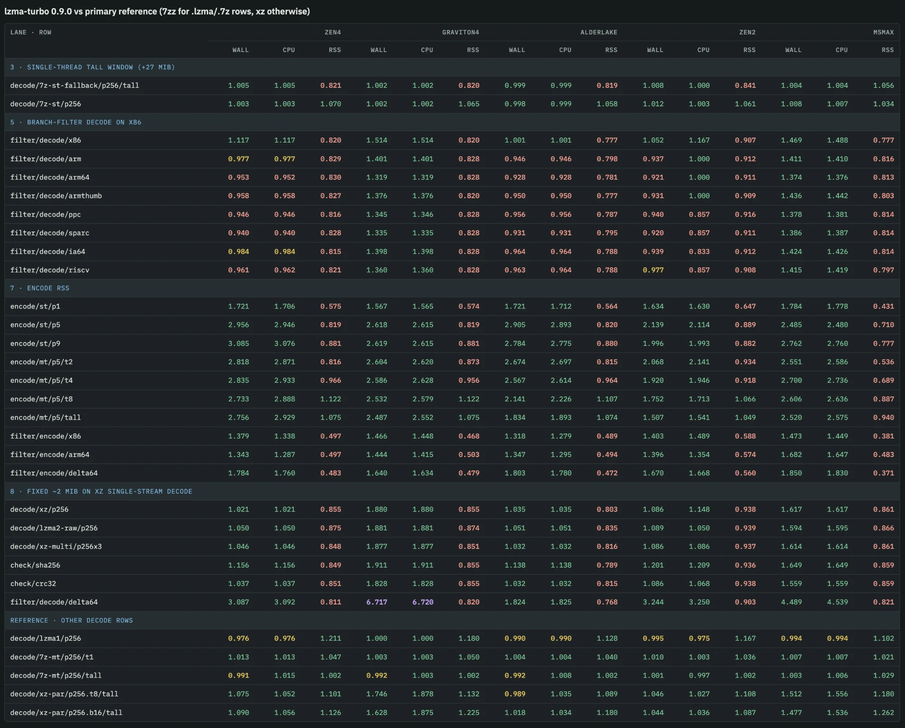

# Benchmarks

Current fleet measurements of lzma-turbo 0.9.0 against xz 5.8.3, 7-Zip 26.03,
lzma-rust2 0.20.1 and liblzma (the `liblzma` crate 0.4.8 over XZ Utils) on
five CPUs. Taken 2026-10-13 with the fleet harness in
[`bench/lzma-turbo-bench`](../bench/lzma-turbo-bench) (`--profile fleet`,
3 timed repeats after 1 warm-up, medians, 256 MiB payloads). How to reproduce
a measurement is in [benchmarking.md](benchmarking.md); the 0.9.0 encoder
audit with its retained samples is in
[encoder-perf-0.9.0.md](encoder-perf-0.9.0.md). Earlier results are in this
file's git history.

Every ratio is **reference / lzma-turbo**, so above 1.000 means lzma-turbo
took less wall time, less CPU time or less peak memory than the reference on
that row. Values below 0.970 are in bold. A dash means the reference does not
run that row (xz has no `.7z` or LZMA1 path, 7-Zip has no raw xz filter path)
or the row was not run on that host. `t1`, `t2`, `t4`, `t8` are fixed thread
counts, `tall` is every hardware thread the host has; `p1`, `p5`, `p9` are
presets.

Build: `lzma-turbo` 0.9.0 default features (`asm` loops, `crc-fast` 1.10.0,
`aws-lc-rs` 1.18.1 SHA-256), release profile, rustc 1.97.1. xz and 7-Zip
are the official 5.8.3 and 26.03 binaries for each platform.

## Hosts

| column | CPU | threads | OS | 7-Zip build |
| --- | --- | ---: | --- | --- |
| Zen 4 | AMD EPYC 9R14 (Zen 4, AVX-512) | 16 | Linux, c7a.4xlarge | 7-Zip (z) 26.03 (x64) |
| Graviton4 | AWS Graviton4 (Neoverse V2, SVE2) | 16 | Linux, c8g.4xlarge | 7-Zip (z) 26.03 (arm64) |
| Alder Lake | Intel Core i5-1240P (Alder Lake, hybrid P/E) | 16 | Linux | 7-Zip (z) 26.03 (x64) |
| Zen 2 | AMD Ryzen 5 3600 (Zen 2) | 12 | Windows | 7-Zip (a) 26.03 (x64) |
| M5 Max | Apple M5 Max | 18 | macOS, shared with other work during the run | 7-Zip (z) 26.03 (arm64) |

The M5 Max ran beside other work (load average 3.4 to 5.0 over the run), so
treat its small differences with care; the other four were idle.

## Summary

Geometric mean of the per-row ratios on each host, over every row that
reference runs.

| CPU | threads | vs xz: decode wall | encode wall | peak RSS | vs 7-Zip: decode wall | peak RSS |
| --- | ---: | ---: | ---: | ---: | ---: | ---: |
| Zen 4 | 16 | 1.08 | 1.84 | 0.71 | 0.99 | 1.05 |
| Graviton4 | 16 | 1.76 | 1.80 | 0.71 | 1.00 | 1.04 |
| Alder Lake | 16 | 1.03 | 1.71 | 0.69 | 1.00 | 1.03 |
| Zen 2 | 12 | 1.09 | 1.60 | 0.77 | 1.01 | 1.04 |
| M5 Max | 18 | 1.59 | 1.84 | 0.65 | 1.01 | 1.06 |

## lzma-turbo vs xz

### decode-lzma1

| scenario | Zen 4 wall | Zen 4 CPU | Zen 4 RSS | Graviton4 wall | Graviton4 CPU | Graviton4 RSS | Alder Lake wall | Alder Lake CPU | Alder Lake RSS | Zen 2 wall | Zen 2 CPU | Zen 2 RSS | M5 Max wall | M5 Max CPU | M5 Max RSS |
| --- | ---: | ---: | ---: | ---: | ---: | ---: | ---: | ---: | ---: | ---: | ---: | ---: | ---: | ---: | ---: |
| `decode/lzma1/p256` | 1.029 | 1.029 | **0.877** | 1.827 | 1.827 | **0.874** | 1.038 | 1.038 | **0.819** | 1.085 | 1.124 | **0.942** | 1.556 | 1.556 | **0.868** |

### decode-xz

| scenario | Zen 4 wall | Zen 4 CPU | Zen 4 RSS | Graviton4 wall | Graviton4 CPU | Graviton4 RSS | Alder Lake wall | Alder Lake CPU | Alder Lake RSS | Zen 2 wall | Zen 2 CPU | Zen 2 RSS | M5 Max wall | M5 Max CPU | M5 Max RSS |
| --- | ---: | ---: | ---: | ---: | ---: | ---: | ---: | ---: | ---: | ---: | ---: | ---: | ---: | ---: | ---: |
| `decode/xz/p256` | 1.021 | 1.021 | **0.855** | 1.880 | 1.880 | **0.855** | 1.035 | 1.035 | **0.803** | 1.086 | 1.148 | **0.938** | 1.617 | 1.617 | **0.861** |
| `decode/lzma2-raw/p256` | 1.050 | 1.050 | **0.875** | 1.881 | 1.881 | **0.874** | 1.051 | 1.051 | **0.835** | 1.089 | 1.050 | **0.939** | 1.594 | 1.595 | **0.866** |
| `decode/xz-multi/p256x3` | 1.046 | 1.046 | **0.848** | 1.877 | 1.877 | **0.851** | 1.032 | 1.032 | **0.816** | 1.086 | 1.086 | **0.937** | 1.614 | 1.614 | **0.861** |

### decode-xz-par

| scenario | Zen 4 wall | Zen 4 CPU | Zen 4 RSS | Graviton4 wall | Graviton4 CPU | Graviton4 RSS | Alder Lake wall | Alder Lake CPU | Alder Lake RSS | Zen 2 wall | Zen 2 CPU | Zen 2 RSS | M5 Max wall | M5 Max CPU | M5 Max RSS |
| --- | ---: | ---: | ---: | ---: | ---: | ---: | ---: | ---: | ---: | ---: | ---: | ---: | ---: | ---: | ---: |
| `decode/xz-par/p256.t8/t1` | 1.028 | 1.028 | **0.208** | 1.886 | 1.886 | **0.204** | 1.030 | 1.030 | **0.209** | 1.077 | 1.120 | **0.174** | 1.603 | 1.604 | **0.140** |
| `decode/xz-par/p256.t8/tall` | 1.075 | 1.052 | 1.101 | 1.746 | 1.878 | 1.132 | 0.989 | 1.035 | 1.089 | 1.046 | 1.027 | 1.108 | 1.512 | 1.556 | 1.180 |
| `decode/xz-par/p256.b16/t1` | 1.029 | 1.028 | **0.300** | 1.884 | 1.884 | **0.295** | 1.027 | 1.027 | **0.297** | 1.075 | 1.127 | **0.251** | 1.612 | 1.613 | **0.204** |
| `decode/xz-par/p256.b16/tall` | 1.090 | 1.056 | 1.126 | 1.628 | 1.875 | 1.225 | 1.018 | 1.034 | 1.180 | 1.044 | 1.036 | 1.087 | 1.477 | 1.536 | 1.262 |
| `decode/xz-par/1g.t8/tall` | 1.091 | 1.060 | 1.130 | 1.824 | 1.892 | 1.196 | 1.063 | 1.043 | 1.079 | 1.047 | 1.068 | 1.109 | 1.551 | 1.559 | 0.999 |

### encode

| scenario | Zen 4 wall | Zen 4 CPU | Zen 4 RSS | Graviton4 wall | Graviton4 CPU | Graviton4 RSS | Alder Lake wall | Alder Lake CPU | Alder Lake RSS | Zen 2 wall | Zen 2 CPU | Zen 2 RSS | M5 Max wall | M5 Max CPU | M5 Max RSS |
| --- | ---: | ---: | ---: | ---: | ---: | ---: | ---: | ---: | ---: | ---: | ---: | ---: | ---: | ---: | ---: |
| `encode/st/p1` | 1.721 | 1.706 | **0.575** | 1.567 | 1.565 | **0.574** | 1.721 | 1.712 | **0.564** | 1.634 | 1.630 | **0.647** | 1.784 | 1.778 | **0.431** |
| `encode/st/p5` | 2.956 | 2.946 | **0.819** | 2.618 | 2.615 | **0.819** | 2.905 | 2.893 | **0.820** | 2.139 | 2.114 | **0.889** | 2.485 | 2.480 | **0.710** |
| `encode/st/p9` | 3.085 | 3.076 | **0.881** | 2.619 | 2.615 | **0.881** | 2.784 | 2.775 | **0.880** | 1.996 | 1.993 | **0.882** | 2.762 | 2.760 | **0.777** |

### encode-mt

| scenario | Zen 4 wall | Zen 4 CPU | Zen 4 RSS | Graviton4 wall | Graviton4 CPU | Graviton4 RSS | Alder Lake wall | Alder Lake CPU | Alder Lake RSS | Zen 2 wall | Zen 2 CPU | Zen 2 RSS | M5 Max wall | M5 Max CPU | M5 Max RSS |
| --- | ---: | ---: | ---: | ---: | ---: | ---: | ---: | ---: | ---: | ---: | ---: | ---: | ---: | ---: | ---: |
| `encode/mt/p5/t2` | 2.818 | 2.871 | **0.816** | 2.604 | 2.620 | **0.873** | 2.674 | 2.697 | **0.815** | 2.068 | 2.141 | **0.934** | 2.551 | 2.586 | **0.536** |
| `encode/mt/p5/t4` | 2.835 | 2.933 | **0.966** | 2.586 | 2.628 | **0.956** | 2.567 | 2.614 | **0.964** | 1.920 | 1.946 | **0.918** | 2.700 | 2.736 | **0.689** |
| `encode/mt/p5/t8` | 2.733 | 2.888 | 1.122 | 2.532 | 2.579 | 1.122 | 2.141 | 2.226 | 1.107 | 1.752 | 1.713 | 1.066 | 2.606 | 2.636 | **0.887** |
| `encode/mt/p5/tall` | 2.756 | 2.929 | 1.075 | 2.487 | 2.552 | 1.075 | 1.834 | 1.893 | 1.074 | 1.507 | 1.541 | 1.049 | 2.520 | 2.575 | **0.940** |

### filter

| scenario | Zen 4 wall | Zen 4 CPU | Zen 4 RSS | Graviton4 wall | Graviton4 CPU | Graviton4 RSS | Alder Lake wall | Alder Lake CPU | Alder Lake RSS | Zen 2 wall | Zen 2 CPU | Zen 2 RSS | M5 Max wall | M5 Max CPU | M5 Max RSS |
| --- | ---: | ---: | ---: | ---: | ---: | ---: | ---: | ---: | ---: | ---: | ---: | ---: | ---: | ---: | ---: |
| `filter/decode/x86` | 1.117 | 1.117 | **0.820** | 1.514 | 1.514 | **0.820** | 1.001 | 1.001 | **0.777** | 1.052 | 1.167 | **0.907** | 1.469 | 1.488 | **0.777** |
| `filter/encode/x86` | 1.379 | 1.338 | **0.497** | 1.466 | 1.448 | **0.468** | 1.318 | 1.279 | **0.489** | 1.403 | 1.489 | **0.588** | 1.473 | 1.449 | **0.381** |
| `filter/decode/arm64` | **0.953** | **0.952** | **0.830** | 1.319 | 1.319 | **0.828** | **0.928** | **0.928** | **0.781** | **0.921** | 1.000 | **0.911** | 1.374 | 1.376 | **0.813** |
| `filter/encode/arm64` | 1.343 | 1.287 | **0.497** | 1.444 | 1.415 | **0.503** | 1.347 | 1.295 | **0.494** | 1.396 | 1.354 | **0.574** | 1.682 | 1.647 | **0.483** |
| `filter/decode/arm` | 0.977 | 0.977 | **0.829** | 1.401 | 1.401 | **0.828** | **0.946** | **0.946** | **0.798** | **0.937** | 1.000 | **0.912** | 1.411 | 1.410 | **0.816** |
| `filter/encode/arm` | 1.343 | 1.298 | **0.507** | 1.437 | 1.417 | **0.499** | 1.285 | 1.248 | **0.492** | 1.409 | 1.362 | **0.574** | 1.198 | 1.184 | **0.413** |
| `filter/decode/armthumb` | **0.958** | **0.958** | **0.827** | 1.376 | 1.376 | **0.820** | **0.950** | **0.950** | **0.777** | **0.931** | 1.000 | **0.909** | 1.436 | 1.442 | **0.803** |
| `filter/encode/armthumb` | 1.325 | 1.280 | **0.510** | 1.471 | 1.449 | **0.491** | 1.368 | 1.322 | **0.496** | 1.403 | 1.375 | **0.597** | 1.440 | 1.414 | **0.443** |
| `filter/decode/ppc` | **0.946** | **0.946** | **0.816** | 1.345 | 1.346 | **0.828** | **0.956** | **0.956** | **0.787** | **0.940** | **0.857** | **0.916** | 1.378 | 1.381 | **0.814** |
| `filter/encode/ppc` | 1.345 | 1.290 | **0.505** | 1.469 | 1.443 | **0.495** | 1.321 | 1.272 | **0.490** | 1.416 | 1.396 | **0.576** | 1.453 | 1.424 | **0.467** |
| `filter/decode/sparc` | **0.940** | **0.940** | **0.828** | 1.335 | 1.335 | **0.828** | **0.931** | **0.931** | **0.795** | **0.920** | **0.857** | **0.911** | 1.386 | 1.387 | **0.814** |
| `filter/encode/sparc` | 1.331 | 1.274 | **0.506** | 1.465 | 1.437 | **0.493** | 1.291 | 1.242 | **0.491** | 1.414 | 1.340 | **0.602** | 1.377 | 1.348 | **0.508** |
| `filter/decode/ia64` | 0.984 | 0.984 | **0.815** | 1.398 | 1.398 | **0.828** | **0.964** | **0.964** | **0.788** | **0.939** | **0.833** | **0.912** | 1.424 | 1.426 | **0.814** |
| `filter/encode/ia64` | 1.353 | 1.302 | **0.507** | 1.448 | 1.427 | **0.500** | 1.254 | 1.209 | **0.492** | 1.391 | 1.354 | **0.572** | 1.442 | 1.418 | **0.465** |
| `filter/decode/riscv` | **0.961** | **0.962** | **0.821** | 1.360 | 1.360 | **0.828** | **0.963** | **0.964** | **0.788** | 0.977 | **0.857** | **0.908** | 1.415 | 1.419 | **0.797** |
| `filter/encode/riscv` | 1.356 | 1.302 | **0.468** | 1.431 | 1.405 | **0.487** | 1.285 | 1.231 | **0.486** | 1.418 | 1.306 | **0.572** | 1.433 | 1.404 | **0.398** |
| `filter/decode/delta4` | 1.039 | 1.039 | **0.824** | 1.795 | 1.795 | **0.837** | 1.045 | 1.045 | **0.790** | 1.088 | 1.105 | **0.878** | 1.593 | 1.591 | **0.806** |
| `filter/encode/delta4` | 1.758 | 1.733 | **0.490** | 1.530 | 1.524 | **0.485** | 1.582 | 1.563 | **0.483** | 1.665 | 1.655 | **0.562** | 1.824 | 1.804 | **0.402** |
| `filter/decode/delta64` | 3.087 | 3.092 | **0.811** | 6.717 | 6.720 | **0.820** | 1.824 | 1.825 | **0.768** | 3.244 | 3.250 | **0.903** | 4.489 | 4.539 | **0.821** |
| `filter/encode/delta64` | 1.784 | 1.760 | **0.483** | 1.640 | 1.634 | **0.479** | 1.803 | 1.780 | **0.472** | 1.670 | 1.668 | **0.560** | 1.850 | 1.830 | **0.371** |

### check

| scenario | Zen 4 wall | Zen 4 CPU | Zen 4 RSS | Graviton4 wall | Graviton4 CPU | Graviton4 RSS | Alder Lake wall | Alder Lake CPU | Alder Lake RSS | Zen 2 wall | Zen 2 CPU | Zen 2 RSS | M5 Max wall | M5 Max CPU | M5 Max RSS |
| --- | ---: | ---: | ---: | ---: | ---: | ---: | ---: | ---: | ---: | ---: | ---: | ---: | ---: | ---: | ---: |
| `check/none` | 1.046 | 1.046 | **0.851** | 1.828 | 1.828 | **0.855** | 1.033 | 1.033 | **0.830** | 1.088 | 1.066 | **0.938** | 1.560 | 1.557 | **0.860** |
| `check/crc32` | 1.037 | 1.037 | **0.851** | 1.828 | 1.828 | **0.855** | 1.032 | 1.032 | **0.815** | 1.086 | 1.068 | **0.938** | 1.559 | 1.559 | **0.859** |
| `check/crc64` | 1.046 | 1.046 | **0.851** | 1.878 | 1.878 | **0.856** | 1.033 | 1.033 | **0.826** | 1.086 | 1.061 | **0.937** | 1.609 | 1.609 | **0.860** |
| `check/sha256` | 1.156 | 1.156 | **0.849** | 1.911 | 1.911 | **0.855** | 1.138 | 1.138 | **0.789** | 1.201 | 1.209 | **0.936** | 1.649 | 1.649 | **0.859** |

## lzma-turbo vs 7-Zip

### decode-lzma1

| scenario | Zen 4 wall | Zen 4 CPU | Zen 4 RSS | Graviton4 wall | Graviton4 CPU | Graviton4 RSS | Alder Lake wall | Alder Lake CPU | Alder Lake RSS | Zen 2 wall | Zen 2 CPU | Zen 2 RSS | M5 Max wall | M5 Max CPU | M5 Max RSS |
| --- | ---: | ---: | ---: | ---: | ---: | ---: | ---: | ---: | ---: | ---: | ---: | ---: | ---: | ---: | ---: |
| `decode/lzma1/p256` | 0.976 | 0.976 | 1.211 | 1.000 | 1.000 | 1.180 | 0.990 | 0.990 | 1.128 | 0.995 | 0.975 | 1.167 | 0.994 | 0.994 | 1.102 |

### decode-xz

| scenario | Zen 4 wall | Zen 4 CPU | Zen 4 RSS | Graviton4 wall | Graviton4 CPU | Graviton4 RSS | Alder Lake wall | Alder Lake CPU | Alder Lake RSS | Zen 2 wall | Zen 2 CPU | Zen 2 RSS | M5 Max wall | M5 Max CPU | M5 Max RSS |
| --- | ---: | ---: | ---: | ---: | ---: | ---: | ---: | ---: | ---: | ---: | ---: | ---: | ---: | ---: | ---: |
| `decode/xz/p256` | 0.981 | 0.981 | 1.208 | 1.019 | 1.019 | 1.176 | 1.016 | 1.015 | 1.157 | 1.016 | 1.083 | 1.186 | 1.020 | 1.020 | 1.123 |

### decode-7z

| scenario | Zen 4 wall | Zen 4 CPU | Zen 4 RSS | Graviton4 wall | Graviton4 CPU | Graviton4 RSS | Alder Lake wall | Alder Lake CPU | Alder Lake RSS | Zen 2 wall | Zen 2 CPU | Zen 2 RSS | M5 Max wall | M5 Max CPU | M5 Max RSS |
| --- | ---: | ---: | ---: | ---: | ---: | ---: | ---: | ---: | ---: | ---: | ---: | ---: | ---: | ---: | ---: |
| `decode/7z-st/p256` | 1.003 | 1.003 | 1.070 | 1.002 | 1.002 | 1.065 | 0.998 | 0.999 | 1.058 | 1.012 | 1.003 | 1.061 | 1.008 | 1.007 | 1.034 |
| `decode/7z-st-fallback/p256/tall` | 1.005 | 1.005 | **0.821** | 1.002 | 1.002 | **0.820** | 0.999 | 0.999 | **0.819** | 1.008 | 1.000 | **0.841** | 1.004 | 1.004 | 1.056 |

### decode-7z-mt

| scenario | Zen 4 wall | Zen 4 CPU | Zen 4 RSS | Graviton4 wall | Graviton4 CPU | Graviton4 RSS | Alder Lake wall | Alder Lake CPU | Alder Lake RSS | Zen 2 wall | Zen 2 CPU | Zen 2 RSS | M5 Max wall | M5 Max CPU | M5 Max RSS |
| --- | ---: | ---: | ---: | ---: | ---: | ---: | ---: | ---: | ---: | ---: | ---: | ---: | ---: | ---: | ---: |
| `decode/7z-mt/p256/t1` | 1.013 | 1.013 | 1.047 | 1.003 | 1.003 | 1.050 | 1.004 | 1.004 | 1.040 | 1.010 | 1.003 | 1.036 | 1.007 | 1.007 | 1.021 |
| `decode/7z-mt/p256/tall` | 0.991 | 1.015 | 1.002 | 0.992 | 1.003 | 1.002 | 0.992 | 1.008 | 1.002 | 1.001 | 0.997 | 1.002 | 1.003 | 1.006 | 1.029 |

## lzma-turbo vs lzma-rust2

### decode-7z-mt

| scenario | Zen 4 wall | Zen 4 CPU | Zen 4 RSS | Graviton4 wall | Graviton4 CPU | Graviton4 RSS | Alder Lake wall | Alder Lake CPU | Alder Lake RSS | Zen 2 wall | Zen 2 CPU | Zen 2 RSS | M5 Max wall | M5 Max CPU | M5 Max RSS |
| --- | ---: | ---: | ---: | ---: | ---: | ---: | ---: | ---: | ---: | ---: | ---: | ---: | ---: | ---: | ---: |
| `decode/7z-mt/p256/t1` | 1.603 | 1.606 | 14.6 | 1.478 | 1.486 | 14.8 | 1.431 | 1.432 | 14.3 | 1.551 | 1.593 | 14.9 | 1.624 | 1.622 | 21.2 |
| `decode/7z-mt/p256/tall` | 1.483 | 1.530 | 1.351 | 1.432 | 1.459 | 1.352 | 2.659 | 1.378 | 1.092 | 1.506 | 1.530 | 1.426 | 3.159 | 1.599 | 1.564 |

## lzma-turbo vs liblzma

### decode-xz-par

| scenario | Zen 4 wall | Zen 4 CPU | Zen 4 RSS | Graviton4 wall | Graviton4 CPU | Graviton4 RSS | Alder Lake wall | Alder Lake CPU | Alder Lake RSS | Zen 2 wall | Zen 2 CPU | Zen 2 RSS | M5 Max wall | M5 Max CPU | M5 Max RSS |
| --- | ---: | ---: | ---: | ---: | ---: | ---: | ---: | ---: | ---: | ---: | ---: | ---: | ---: | ---: | ---: |
| `decode/xz-par/p256.t8/t1` | 1.129 | 1.128 | **0.238** | 1.915 | 1.915 | **0.228** | 1.045 | 1.045 | **0.247** | 1.123 | 1.154 | **0.183** | 1.595 | 1.596 | **0.160** |
| `decode/xz-par/p256.t8/tall` | 1.114 | 1.148 | 1.098 | 1.761 | 1.903 | 1.138 | 1.022 | 1.038 | 1.077 | 1.082 | 1.124 | 1.132 | 1.505 | 1.552 | 1.185 |
| `decode/xz-par/p256.b16/t1` | 1.131 | 1.130 | **0.340** | 1.916 | 1.916 | **0.330** | 1.040 | 1.040 | **0.351** | 1.120 | 1.183 | **0.265** | 1.586 | 1.587 | **0.235** |
| `decode/xz-par/p256.b16/tall` | 1.122 | 1.156 | 1.165 | 1.630 | 1.898 | 1.237 | 1.039 | 1.055 | 1.194 | 1.117 | 1.128 | 1.105 | 1.463 | 1.532 | 1.267 |
| `decode/xz-par/1g.t8/tall` | 1.158 | 1.155 | 1.132 | 1.846 | 1.916 | 1.166 | 1.058 | 1.054 | 1.079 | 1.133 | 1.153 | 1.086 | 1.560 | 1.562 | 1.020 |

## Raw filter throughput

The BCJ, BCJ2 and delta filters on their own, MiB/s of lzma-turbo on each
host, single thread. No reference runs a filter without a coder behind it,
so these rows have no ratio.

| scenario | Zen 4 | Graviton4 | Alder Lake | Zen 2 | M5 Max |
| --- | ---: | ---: | ---: | ---: | ---: |
| `filter/raw/x86/encode` | 7966 | 6155 | 7473 | 3608 | 9200 |
| `filter/raw/x86/decode` | 8069 | 6192 | 6678 | 3616 | 9439 |
| `filter/raw/arm64/encode` | 2635 | 2294 | 2785 | 2260 | 4335 |
| `filter/raw/arm64/decode` | 2626 | 2299 | 3014 | 2265 | 4276 |
| `filter/raw/arm/encode` | 8841 | 6238 | 8976 | 6341 | 14916 |
| `filter/raw/arm/decode` | 6753 | 6780 | 7497 | 6262 | 14705 |
| `filter/raw/armthumb/encode` | 3418 | 3390 | 4353 | 3325 | 7205 |
| `filter/raw/armthumb/decode` | 3422 | 3392 | 4847 | 3326 | 7104 |
| `filter/raw/ppc/encode` | 2709 | 3034 | 2957 | 2807 | 5192 |
| `filter/raw/ppc/decode` | 2712 | 3055 | 3431 | 2885 | 5025 |
| `filter/raw/sparc/encode` | 2688 | 2725 | 3530 | 2487 | 4442 |
| `filter/raw/sparc/decode` | 2625 | 2606 | 3257 | 2459 | 4472 |
| `filter/raw/ia64/encode` | 4936 | 5236 | 4581 | 4745 | 8085 |
| `filter/raw/ia64/decode` | 4878 | 5254 | 4251 | 4689 | 7959 |
| `filter/raw/riscv/encode` | 2587 | 2624 | 2644 | 2388 | 4459 |
| `filter/raw/riscv/decode` | 2540 | 2631 | 2683 | 2454 | 4478 |
| `filter/raw/delta4/encode` | 2782 | 1745 | 2584 | 2020 | 3911 |
| `filter/raw/delta4/decode` | 1791 | 1330 | 1965 | 1827 | 1673 |
| `filter/raw/delta64/encode` | 2679 | 1744 | 2605 | 2004 | 3792 |
| `filter/raw/delta64/decode` | 21774 | 17041 | 14067 | 9670 | 19764 |
| `filter/raw/bcj2/encode` | 748 | 776 | 937 | 714 | 1371 |
| `filter/raw/bcj2/decode` | 719 | 948 | 1180 | 876 | 1588 |

## Lane view

The same run grouped by the rows that are still behind parity, one lane per gap, against the primary reference for each row (7-Zip for `.7z` and `.lzma` rows, xz otherwise). Click the image for the full-size version.

