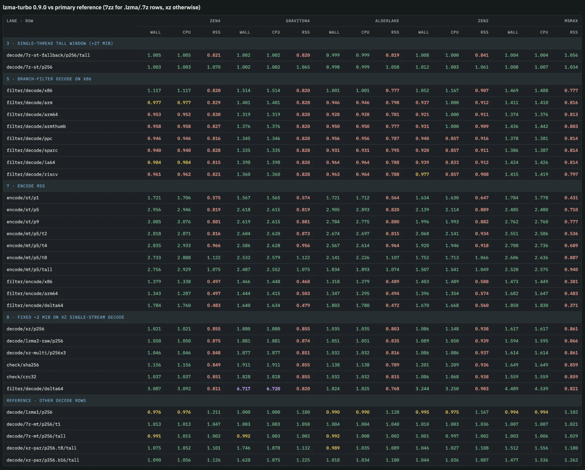

# Benchmarks

Current measurements of lzma-turbo 0.10.3 against xz 5.8.4, 7-Zip 26.04 and
three Rust libraries: lzma-rust2 0.20.1, liblzma (the `liblzma` crate 0.4.8
over XZ Utils) and lzma-rs 0.3.0, on two CPUs. Taken 2026-11-08 with the
fleet harness in [`bench/lzma-turbo-bench`](../bench/lzma-turbo-bench)
(`--profile fleet`, 3 timed repeats after 1 warm-up, medians, 256 MiB
payloads). How to reproduce a measurement is in
[benchmarking.md](benchmarking.md); the 0.9.0 encoder audit with its
retained samples is in [encoder-perf-0.9.0.md](encoder-perf-0.9.0.md).
Earlier results, including the 0.10.1 round of 2026-10-18 and the
five-machine 0.9.0 round of 2026-10-13, are in this file's git history.

Every ratio is **reference / lzma-turbo**, so above 1.000 means lzma-turbo
took less wall time, less CPU time or less peak memory than the reference on
that row. Values below 0.970 are in bold. A dash means the reference does not
run that row or the row was not run on that host. A reference that does not
run any row of a group has no table for it: xz has no `.7z` or LZMA1 path,
7-Zip has no raw xz filter path, and the Rust libraries run only the decode
and encode rows. `t1`, `t2`, `t4`, `t8` are fixed thread counts, `tall` is
every hardware thread the host has; `p1`, `p5`, `p9` are presets. Encode rows
carry a fourth column, size: reference output bytes / lzma-turbo output bytes
at the same settings. It is 1.000 on every encode row on every host and
against every reference (0.9997 to 1.0002 before rounding), so the speedups
are at the same compression ratio. The Rust libraries encode at the row's
preset with a CRC-64 check, and above one thread at the block size `xz -T`
uses.

Build: `lzma-turbo` 0.10.3 default features (`asm` loops, `crc-turbo`
1.11.0, `aws-lc-rs` 1.18.1 SHA-256), release profile, rustc 1.97.1. The Rust
libraries are built into the same `lzma-bench` binary with the versions in
`Cargo.lock`, liblzma with its `parallel` feature. xz is built from the
official 5.8.4 source release, and 7-Zip is the official 26.04 binary for
each platform.

## Hosts

| column | CPU | threads | OS | 7-Zip build |
| --- | --- | ---: | --- | --- |
| Sapphire Rapids | Intel Xeon Platinum 8488C (Sapphire Rapids, AVX-512) | 16 | Linux, c7i.4xlarge | 7-Zip (z) 26.04 (x64) |
| Graviton4 | AWS Graviton4 (Neoverse V2, SVE2) | 16 | Linux, c8g.4xlarge | 7-Zip (z) 26.04 (arm64) |

Both hosts were idle.

## Summary

Geometric mean of the per-row ratios on each host, over every row that
reference runs except `decode/lzma2-raw/p256` (see below).

| CPU | threads | vs xz: decode wall | encode wall | peak RSS | vs 7-Zip: decode wall | peak RSS |
| --- | ---: | ---: | ---: | ---: | ---: | ---: |
| Sapphire Rapids | 16 | 1.10 | 1.87 | 0.86 | 1.00 | 1.08 |
| Graviton4 | 16 | 1.82 | 1.94 | 0.88 | 1.00 | 1.09 |

The Rust libraries, the same way. Their decode column covers the
single-thread rows only; the all-thread rows are in the sections below.

| CPU | vs lzma-rust2: decode wall | encode wall | peak RSS | vs liblzma: decode wall | encode wall | peak RSS | vs lzma-rs: decode wall |
| --- | ---: | ---: | ---: | ---: | ---: | ---: | ---: |
| Sapphire Rapids | 1.46 | 2.54 | 1.28 | 1.08 | 2.53 | 1.06 | 2.83 |
| Graviton4 | 1.53 | 2.48 | 1.31 | 1.91 | 2.44 | 1.07 | 3.01 |

## lzma-turbo vs xz

`decode/lzma2-raw/p256` is not like for like: lzma-turbo decodes the bare
LZMA2 stream while xz decodes the whole `.xz` container around it, framing
and check included. It is shown but left out of the summary.

### decode-lzma1

| scenario | Sapphire Rapids wall | Sapphire Rapids CPU | Sapphire Rapids RSS | Graviton4 wall | Graviton4 CPU | Graviton4 RSS |
| --- | ---: | ---: | ---: | ---: | ---: | ---: |
| `decode/lzma1/p256` | 1.050 | 1.050 | **0.830** | 1.837 | 1.837 | **0.864** |

### decode-xz

| scenario | Sapphire Rapids wall | Sapphire Rapids CPU | Sapphire Rapids RSS | Graviton4 wall | Graviton4 CPU | Graviton4 RSS |
| --- | ---: | ---: | ---: | ---: | ---: | ---: |
| `decode/xz/p256` | 1.052 | 1.052 | **0.888** | 1.896 | 1.897 | **0.914** |
| `decode/lzma2-raw/p256` | 1.056 | 1.056 | **0.897** | 1.900 | 1.900 | **0.947** |
| `decode/xz-multi/p256x3` | 1.055 | 1.055 | **0.867** | 1.896 | 1.896 | **0.899** |

### decode-xz-par

| scenario | Sapphire Rapids wall | Sapphire Rapids CPU | Sapphire Rapids RSS | Graviton4 wall | Graviton4 CPU | Graviton4 RSS |
| --- | ---: | ---: | ---: | ---: | ---: | ---: |
| `decode/xz-par/p256.t8/t1` | 1.054 | 1.054 | **0.853** | 1.893 | 1.893 | **0.888** |
| `decode/xz-par/p256.t8/tall` | 1.014 | 1.061 | 1.098 | 1.749 | 1.883 | 1.133 |
| `decode/xz-par/p256.b16/t1` | 1.055 | 1.055 | **0.855** | 1.893 | 1.893 | **0.888** |
| `decode/xz-par/p256.b16/tall` | 1.005 | 1.070 | 1.179 | 1.636 | 1.881 | 1.228 |
| `decode/xz-par/1g.t8/tall` | 1.038 | 1.069 | 1.299 | 1.834 | 1.899 | 1.304 |

### encode

| scenario | Sapphire Rapids wall | Sapphire Rapids CPU | Sapphire Rapids RSS | Sapphire Rapids size | Graviton4 wall | Graviton4 CPU | Graviton4 RSS | Graviton4 size |
| --- | ---: | ---: | ---: | ---: | ---: | ---: | ---: | ---: |
| `encode/st/p1` | 1.714 | 1.707 | **0.684** | 1.000 | 1.751 | 1.749 | **0.696** | 1.000 |
| `encode/st/p5` | 2.941 | 2.931 | **0.927** | 1.000 | 2.844 | 2.841 | **0.931** | 1.000 |
| `encode/st/p9` | 2.990 | 2.983 | **0.950** | 1.000 | 2.589 | 2.588 | **0.950** | 1.000 |

### encode-mt

| scenario | Sapphire Rapids wall | Sapphire Rapids CPU | Sapphire Rapids RSS | Sapphire Rapids size | Graviton4 wall | Graviton4 CPU | Graviton4 RSS | Graviton4 size |
| --- | ---: | ---: | ---: | ---: | ---: | ---: | ---: | ---: |
| `encode/mt/p5/t2` | 2.808 | 2.840 | 1.237 | 1.000 | 2.862 | 2.874 | 1.154 | 1.000 |
| `encode/mt/p5/t4` | 2.850 | 2.900 | 1.199 | 1.000 | 2.778 | 2.794 | 1.200 | 1.000 |
| `encode/mt/p5/t8` | 2.835 | 2.907 | 1.137 | 1.000 | 2.717 | 2.731 | 1.135 | 1.000 |
| `encode/mt/p5/tall` | 2.416 | 2.614 | 1.082 | 1.000 | 2.665 | 2.694 | 1.082 | 1.000 |

### filter

| scenario | Sapphire Rapids wall | Sapphire Rapids CPU | Sapphire Rapids RSS | Sapphire Rapids size | Graviton4 wall | Graviton4 CPU | Graviton4 RSS | Graviton4 size |
| --- | ---: | ---: | ---: | ---: | ---: | ---: | ---: | ---: |
| `filter/decode/x86` | 1.159 | 1.159 | **0.895** | — | 1.547 | 1.548 | **0.914** | — |
| `filter/encode/x86` | 1.461 | 1.440 | **0.673** | 1.000 | 1.469 | 1.454 | **0.687** | 1.000 |
| `filter/decode/arm64` | 1.002 | 1.002 | **0.890** | — | 1.423 | 1.423 | **0.915** | — |
| `filter/encode/arm64` | 1.456 | 1.432 | **0.671** | 1.000 | 1.483 | 1.466 | **0.687** | 1.000 |
| `filter/decode/arm` | 1.009 | 1.009 | **0.893** | — | 1.454 | 1.454 | **0.914** | — |
| `filter/encode/arm` | 1.427 | 1.410 | **0.666** | 1.000 | 1.610 | 1.593 | **0.687** | 1.000 |
| `filter/decode/armthumb` | 0.991 | 0.992 | **0.893** | — | 1.422 | 1.424 | **0.914** | — |
| `filter/encode/armthumb` | 1.437 | 1.412 | **0.678** | 1.000 | 1.567 | 1.545 | **0.686** | 1.000 |
| `filter/decode/ppc` | 1.029 | 1.029 | **0.889** | — | 1.454 | 1.454 | **0.914** | — |
| `filter/encode/ppc` | 1.430 | 1.413 | **0.675** | 1.000 | 1.492 | 1.479 | **0.687** | 1.000 |
| `filter/decode/sparc` | 0.992 | 0.992 | **0.883** | — | 1.445 | 1.446 | **0.915** | — |
| `filter/encode/sparc` | 1.415 | 1.393 | **0.673** | 1.000 | 1.546 | 1.531 | **0.686** | 1.000 |
| `filter/decode/ia64` | 1.014 | 1.014 | **0.890** | — | 1.446 | 1.446 | **0.914** | — |
| `filter/encode/ia64` | 1.445 | 1.422 | **0.668** | 1.000 | 1.536 | 1.519 | **0.687** | 1.000 |
| `filter/decode/riscv` | 1.020 | 1.020 | **0.888** | — | 1.431 | 1.431 | **0.914** | — |
| `filter/encode/riscv` | 1.434 | 1.409 | **0.671** | 1.000 | 1.539 | 1.516 | **0.687** | 1.000 |
| `filter/decode/delta4` | 1.076 | 1.076 | **0.888** | — | 1.881 | 1.881 | **0.914** | — |
| `filter/encode/delta4` | 1.668 | 1.654 | **0.672** | 1.000 | 1.993 | 1.982 | **0.687** | 1.000 |
| `filter/decode/delta64` | 3.312 | 3.321 | **0.887** | — | 9.042 | 9.051 | **0.914** | — |
| `filter/encode/delta64` | 1.670 | 1.657 | **0.669** | 1.000 | 1.814 | 1.806 | **0.688** | 1.000 |

### check

| scenario | Sapphire Rapids wall | Sapphire Rapids CPU | Sapphire Rapids RSS | Graviton4 wall | Graviton4 CPU | Graviton4 RSS |
| --- | ---: | ---: | ---: | ---: | ---: | ---: |
| `check/none` | 1.053 | 1.053 | **0.892** | 1.847 | 1.847 | **0.915** |
| `check/crc32` | 1.054 | 1.054 | **0.885** | 1.846 | 1.847 | **0.915** |
| `check/crc64` | 1.057 | 1.057 | **0.887** | 1.897 | 1.897 | **0.914** |
| `check/sha256` | 1.147 | 1.147 | **0.887** | 1.931 | 1.931 | **0.914** |

## lzma-turbo vs 7-Zip

### decode-lzma1

| scenario | Sapphire Rapids wall | Sapphire Rapids CPU | Sapphire Rapids RSS | Graviton4 wall | Graviton4 CPU | Graviton4 RSS |
| --- | ---: | ---: | ---: | ---: | ---: | ---: |
| `decode/lzma1/p256` | 0.997 | 0.997 | 1.141 | 0.999 | 0.999 | 1.178 |

### decode-xz

| scenario | Sapphire Rapids wall | Sapphire Rapids CPU | Sapphire Rapids RSS | Graviton4 wall | Graviton4 CPU | Graviton4 RSS |
| --- | ---: | ---: | ---: | ---: | ---: | ---: |
| `decode/xz/p256` | 1.013 | 1.013 | 1.255 | 1.023 | 1.023 | 1.269 |

### decode-7z

| scenario | Sapphire Rapids wall | Sapphire Rapids CPU | Sapphire Rapids RSS | Graviton4 wall | Graviton4 CPU | Graviton4 RSS |
| --- | ---: | ---: | ---: | ---: | ---: | ---: |
| `decode/7z-st/p256` | 1.011 | 1.011 | 1.083 | 1.004 | 1.004 | 1.092 |
| `decode/7z-st-fallback/p256/tall` | 1.013 | 1.013 | 1.007 | 1.002 | 1.002 | 1.007 |

### decode-7z-mt

| scenario | Sapphire Rapids wall | Sapphire Rapids CPU | Sapphire Rapids RSS | Graviton4 wall | Graviton4 CPU | Graviton4 RSS |
| --- | ---: | ---: | ---: | ---: | ---: | ---: |
| `decode/7z-mt/p256/t1` | 1.010 | 1.010 | 1.031 | 1.001 | 1.001 | 1.039 |
| `decode/7z-mt/p256/tall` | 0.986 | 1.004 | 1.001 | 0.991 | 1.003 | 1.001 |

## lzma-turbo vs lzma-rust2

lzma-rust2's `XzReaderMt` decodes every `.xz` file here at its
single-thread speed (8.3 s on Sapphire Rapids, 7.7 s on Graviton4, at one
thread and at all 16), so the `decode/xz-par` all-thread rows set
lzma-turbo's parallel decoder against one lzma-rust2 thread; lzma-turbo's
peak memory is higher there (about 507 MB against 146 MB). Its
`Lzma2ReaderMt` on the `.7z` file went from 7.6 s to 3.9 s with every
thread on Graviton4 and stayed at 8.1 s on Sapphire Rapids.

### decode-lzma1

| scenario | Sapphire Rapids wall | Sapphire Rapids CPU | Sapphire Rapids RSS | Graviton4 wall | Graviton4 CPU | Graviton4 RSS |
| --- | ---: | ---: | ---: | ---: | ---: | ---: |
| `decode/lzma1/p256` | 1.478 | 1.478 | 0.984 | 1.723 | 1.723 | 0.989 |

### decode-xz

| scenario | Sapphire Rapids wall | Sapphire Rapids CPU | Sapphire Rapids RSS | Graviton4 wall | Graviton4 CPU | Graviton4 RSS |
| --- | ---: | ---: | ---: | ---: | ---: | ---: |
| `decode/xz/p256` | 1.501 | 1.501 | 1.058 | 1.581 | 1.581 | 1.069 |

### decode-7z

| scenario | Sapphire Rapids wall | Sapphire Rapids CPU | Sapphire Rapids RSS | Graviton4 wall | Graviton4 CPU | Graviton4 RSS |
| --- | ---: | ---: | ---: | ---: | ---: | ---: |
| `decode/7z-st/p256` | 1.408 | 1.408 | 1.024 | 1.450 | 1.450 | 1.033 |

### decode-7z-mt

| scenario | Sapphire Rapids wall | Sapphire Rapids CPU | Sapphire Rapids RSS | Graviton4 wall | Graviton4 CPU | Graviton4 RSS |
| --- | ---: | ---: | ---: | ---: | ---: | ---: |
| `decode/7z-mt/p256/t1` | 1.455 | 1.456 | 14.3 | 1.474 | 1.482 | 14.7 |
| `decode/7z-mt/p256/tall` | 2.712 | 1.409 | 1.090 | 1.429 | 1.454 | 1.352 |

### decode-xz-par

| scenario | Sapphire Rapids wall | Sapphire Rapids CPU | Sapphire Rapids RSS | Graviton4 wall | Graviton4 CPU | Graviton4 RSS |
| --- | ---: | ---: | ---: | ---: | ---: | ---: |
| `decode/xz-par/p256.t8/t1` | 1.475 | 1.475 | 11.6 | 1.484 | 1.485 | 12.4 |
| `decode/xz-par/p256.t8/tall` | 11.0 | 1.305 | **0.288** | 13.2 | 1.449 | **0.287** |
| `decode/xz-par/p256.b16/t1` | 1.471 | 1.470 | 10.6 | 1.492 | 1.492 | 11.3 |
| `decode/xz-par/p256.b16/tall` | 14.4 | 1.223 | **0.262** | 17.2 | 1.454 | **0.260** |
| `decode/xz-par/1g.t8/tall` | 15.9 | 1.217 | **0.193** | 19.3 | 1.465 | **0.192** |

### encode

| scenario | Sapphire Rapids wall | Sapphire Rapids CPU | Sapphire Rapids RSS | Sapphire Rapids size | Graviton4 wall | Graviton4 CPU | Graviton4 RSS | Graviton4 size |
| --- | ---: | ---: | ---: | ---: | ---: | ---: | ---: | ---: |
| `encode/st/p1` | 1.556 | 1.550 | **0.803** | 1.000 | 1.596 | 1.594 | **0.799** | 1.000 |
| `encode/st/p5` | 2.810 | 2.800 | **0.948** | 1.000 | 2.806 | 2.803 | **0.947** | 1.000 |
| `encode/st/p9` | 2.975 | 2.969 | **0.953** | 1.000 | 2.553 | 2.551 | **0.952** | 1.000 |

### encode-mt

| scenario | Sapphire Rapids wall | Sapphire Rapids CPU | Sapphire Rapids RSS | Sapphire Rapids size | Graviton4 wall | Graviton4 CPU | Graviton4 RSS | Graviton4 size |
| --- | ---: | ---: | ---: | ---: | ---: | ---: | ---: | ---: |
| `encode/mt/p5/t2` | 2.775 | 2.810 | 1.888 | 1.000 | 2.753 | 2.770 | 1.883 | 1.000 |
| `encode/mt/p5/t4` | 2.784 | 2.838 | 1.392 | 1.000 | 2.709 | 2.727 | 1.392 | 1.000 |
| `encode/mt/p5/t8` | 2.798 | 2.879 | 1.146 | 1.000 | 2.632 | 2.657 | 1.144 | 1.000 |
| `encode/mt/p5/tall` | 2.449 | 2.624 | 1.044 | 1.000 | 2.580 | 2.630 | 1.034 | 1.000 |

## lzma-turbo vs liblzma

### decode-lzma1

| scenario | Sapphire Rapids wall | Sapphire Rapids CPU | Sapphire Rapids RSS | Graviton4 wall | Graviton4 CPU | Graviton4 RSS |
| --- | ---: | ---: | ---: | ---: | ---: | ---: |
| `decode/lzma1/p256` | 1.047 | 1.047 | 0.979 | 1.869 | 1.869 | 1.000 |

### decode-xz

| scenario | Sapphire Rapids wall | Sapphire Rapids CPU | Sapphire Rapids RSS | Graviton4 wall | Graviton4 CPU | Graviton4 RSS |
| --- | ---: | ---: | ---: | ---: | ---: | ---: |
| `decode/xz/p256` | 1.085 | 1.085 | 1.058 | 1.925 | 1.925 | 1.057 |

### decode-xz-par

| scenario | Sapphire Rapids wall | Sapphire Rapids CPU | Sapphire Rapids RSS | Graviton4 wall | Graviton4 CPU | Graviton4 RSS |
| --- | ---: | ---: | ---: | ---: | ---: | ---: |
| `decode/xz-par/p256.t8/t1` | 1.088 | 1.088 | 1.015 | 1.920 | 1.920 | 1.028 |
| `decode/xz-par/p256.t8/tall` | 1.043 | 1.088 | 1.100 | 1.761 | 1.905 | 1.138 |
| `decode/xz-par/p256.b16/t1` | 1.088 | 1.088 | 1.018 | 1.920 | 1.920 | 1.028 |
| `decode/xz-par/p256.b16/tall` | 1.026 | 1.099 | 1.186 | 1.642 | 1.905 | 1.234 |
| `decode/xz-par/1g.t8/tall` | 1.069 | 1.094 | 1.213 | 1.849 | 1.923 | 1.238 |

### encode

| scenario | Sapphire Rapids wall | Sapphire Rapids CPU | Sapphire Rapids RSS | Sapphire Rapids size | Graviton4 wall | Graviton4 CPU | Graviton4 RSS | Graviton4 size |
| --- | ---: | ---: | ---: | ---: | ---: | ---: | ---: | ---: |
| `encode/st/p1` | 1.562 | 1.556 | **0.807** | 1.000 | 1.594 | 1.593 | **0.808** | 1.000 |
| `encode/st/p5` | 2.847 | 2.836 | **0.946** | 1.000 | 2.758 | 2.755 | **0.946** | 1.000 |
| `encode/st/p9` | 2.965 | 2.959 | **0.952** | 1.000 | 2.497 | 2.496 | **0.952** | 1.000 |

### encode-mt

| scenario | Sapphire Rapids wall | Sapphire Rapids CPU | Sapphire Rapids RSS | Sapphire Rapids size | Graviton4 wall | Graviton4 CPU | Graviton4 RSS | Graviton4 size |
| --- | ---: | ---: | ---: | ---: | ---: | ---: | ---: | ---: |
| `encode/mt/p5/t2` | 2.761 | 2.790 | 1.245 | 1.000 | 2.702 | 2.727 | 1.160 | 1.000 |
| `encode/mt/p5/t4` | 2.776 | 2.828 | 1.203 | 1.000 | 2.651 | 2.659 | 1.203 | 1.000 |
| `encode/mt/p5/t8` | 2.783 | 2.845 | 1.139 | 1.000 | 2.585 | 2.605 | 1.136 | 1.000 |
| `encode/mt/p5/tall` | 2.372 | 2.562 | 1.084 | 1.000 | 2.546 | 2.569 | 1.083 | 1.000 |

## lzma-turbo vs lzma-rs

lzma-rs decodes on one thread and has no encode row: its encoder writes
literals only. Its peak memory matches lzma-turbo's on LZMA1 (13 MB) and is
far higher on the `.xz` row (541 MB against 12 MB) and the `.7z` row (273 MB
against 37 MB).

### decode-lzma1

| scenario | Sapphire Rapids wall | Sapphire Rapids CPU | Sapphire Rapids RSS | Graviton4 wall | Graviton4 CPU | Graviton4 RSS |
| --- | ---: | ---: | ---: | ---: | ---: | ---: |
| `decode/lzma1/p256` | 2.849 | 2.849 | 0.978 | 2.819 | 2.819 | 0.989 |

### decode-xz

| scenario | Sapphire Rapids wall | Sapphire Rapids CPU | Sapphire Rapids RSS | Graviton4 wall | Graviton4 CPU | Graviton4 RSS |
| --- | ---: | ---: | ---: | ---: | ---: | ---: |
| `decode/xz/p256` | 2.977 | 2.977 | 44.7 | 3.725 | 3.725 | 47.5 |

### decode-7z

| scenario | Sapphire Rapids wall | Sapphire Rapids CPU | Sapphire Rapids RSS | Graviton4 wall | Graviton4 CPU | Graviton4 RSS |
| --- | ---: | ---: | ---: | ---: | ---: | ---: |
| `decode/7z-st/p256` | 2.687 | 2.687 | 7.364 | 2.591 | 2.591 | 7.545 |

## Raw filter throughput

The BCJ, BCJ2 and delta filters on their own, MiB/s of lzma-turbo on each
host, single thread. No reference runs a filter without a coder behind it,
so these rows have no ratio.

| scenario | Sapphire Rapids | Graviton4 |
| --- | ---: | ---: |
| `filter/raw/x86/encode` | 5361 | 6410 |
| `filter/raw/x86/decode` | 5473 | 6477 |
| `filter/raw/arm64/encode` | 4207 | 4735 |
| `filter/raw/arm64/decode` | 4217 | 4774 |
| `filter/raw/arm/encode` | 7510 | 8792 |
| `filter/raw/arm/decode` | 6861 | 8764 |
| `filter/raw/armthumb/encode` | 3325 | 3308 |
| `filter/raw/armthumb/decode` | 3456 | 3384 |
| `filter/raw/ppc/encode` | 7320 | 9738 |
| `filter/raw/ppc/decode` | 7642 | 9841 |
| `filter/raw/sparc/encode` | 5283 | 7969 |
| `filter/raw/sparc/decode` | 5165 | 7464 |
| `filter/raw/ia64/encode` | 4128 | 6084 |
| `filter/raw/ia64/decode` | 4155 | 6108 |
| `filter/raw/riscv/encode` | 4065 | 3512 |
| `filter/raw/riscv/decode` | 3919 | 3527 |
| `filter/raw/delta4/encode` | 2366 | 1733 |
| `filter/raw/delta4/decode` | 5111 | 3921 |
| `filter/raw/delta64/encode` | 2365 | 1736 |
| `filter/raw/delta64/decode` | 8149 | 17364 |
| `filter/raw/bcj2/encode` | 744 | 766 |
| `filter/raw/bcj2/decode` | 1209 | 1287 |

## Lane view

This image is from the earlier 0.9.0 round on five machines and has not been
redrawn for this run. It groups that run by the rows that were still behind
parity, one lane per gap, against the primary reference for each row (7-Zip
for `.7z` and `.lzma` rows, xz otherwise). Click the image for the full-size
version.

